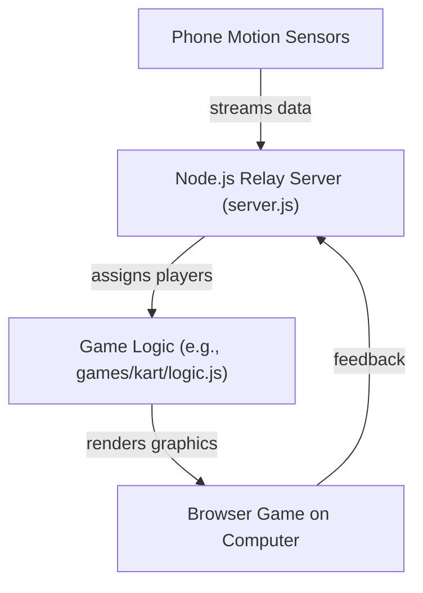

# OpenWii

Motion-controlled games where your phone is the remote.


<!-- Screenshot: add docs/screenshot.png -->

## Overview

OpenWii transforms your smartphone into a motion-sensing game controller for browser-based games hosted on your computer. The system uses real-time inputs from smartphone sensors to control gameplay, enabling a dynamic multiplayer experience with rich visuals and responsive control mechanics.

## Features

- **Smartphone Controller**: Use your phone's motion sensors to interact with games on your computer.
- **Local Node Server**: Hosts games and coordinates inputs and outputs over a local network (`server.js`).
- **Multiplayer Support**: Slots phones into player roles dynamically for group gaming sessions.
- **Real-Time Sensor Integration**: Streams device orientation and motion data with low latency (`core/orientation.js`, `core/pointer.js`).
- **Game Calibration**: Tailor input sensitivity to individual devices with drift correction and axis alignment (`core/calibration.js`).
- **Game Library**: A variety of games like Mario Kart, Alien Attack, and Drawing with dedicated logic modules in the `games` folder.
- **Assets Pipeline**: Build and manage game assets with scripts like `build:kart-assets`.
- **Cert and HTTPS Support**: Generates local certificates for secure browser connections (`scripts/gen-cert.js`).

## How It Works



## Tech Stack

- **Node.js**: Backend server and game coordination.
- **Socket.IO**: Real-time communication between phones and the server.
- **Three.js**: Browser-based rendering for web games.
- **Express.js**: Web server framework.
- **Playwright**: Automated browser testing.

## Getting Started

### Prerequisites

- Node.js v22 or above.

### Installation and Running

1. Clone the repository:
   ```bash
   git clone https://github.com/pattssun/OpenWii.git
   cd OpenWii
   ```

2. Install dependencies:
   ```bash
   npm install
   ```

3. Generate HTTPS certificates:
   ```bash
   npm run cert
   ```

4. Start the server:
   ```bash
   npm run start
   ```

5. Open the game interface in Chrome:
   ```bash
   npm run tv
   ```

## Project Structure

```plaintext
.
├── core/                 # Core utilities like calibration, motion processing, and pointer handling.
├── games/                # Game modules such as Mario Kart, Alien Attack, and Drawing.
├── assets/               # Game assets including audio and 3D models.
├── scripts/              # Utility scripts for tasks like generating certificates.
├── tests/                # Test cases for various system components.
├── LICENSE               # MIT license file.
└── server.js             # Entry point for the Node.js server.
```

## Testing

Run the unit tests for core and game components:

```bash
npm run test:unit
```

Browser-specific Mario Kart tests can be executed as follows:

```bash
npm run test:kart-browser
npm run test:kart-public
```

## Roadmap

- [ ] Document the messaging protocol, including schemas and versioning guidelines.
- [ ] Add more automated test coverage for calibration and multiplayer scenarios.
- [ ] Include a latency and packet-loss test harness for network simulations.
- [ ] Separate core modules into well-defined public APIs.

## License

This project is licensed under the MIT License. See the [LICENSE](LICENSE) file for details.

---

Built by [Alicia Goh](https://github.com/EF361)